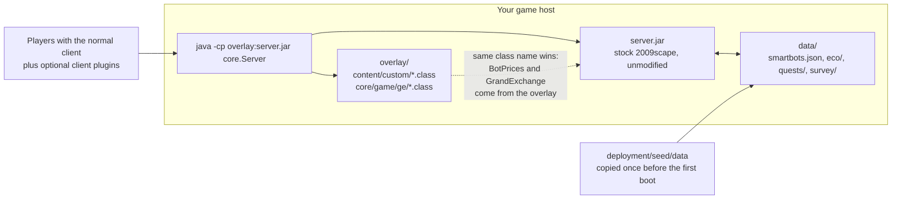
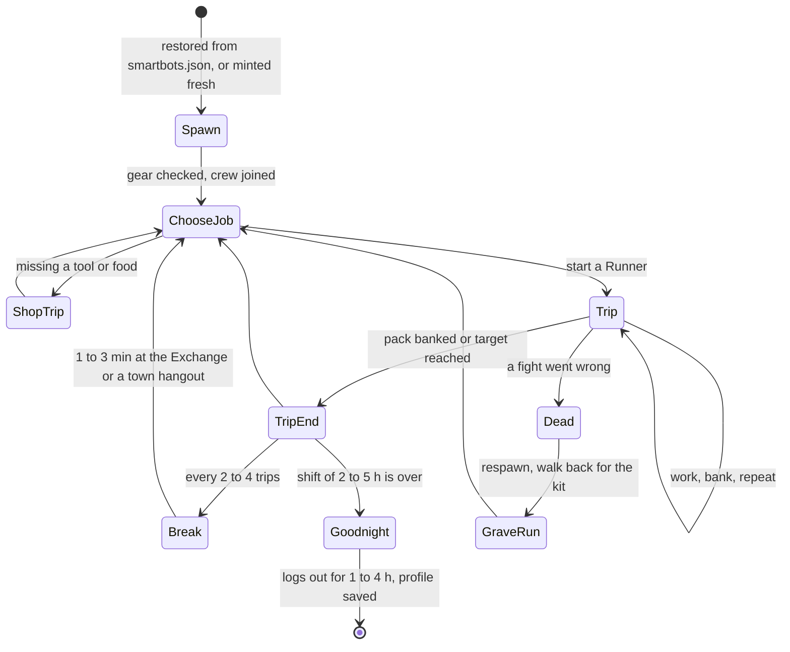
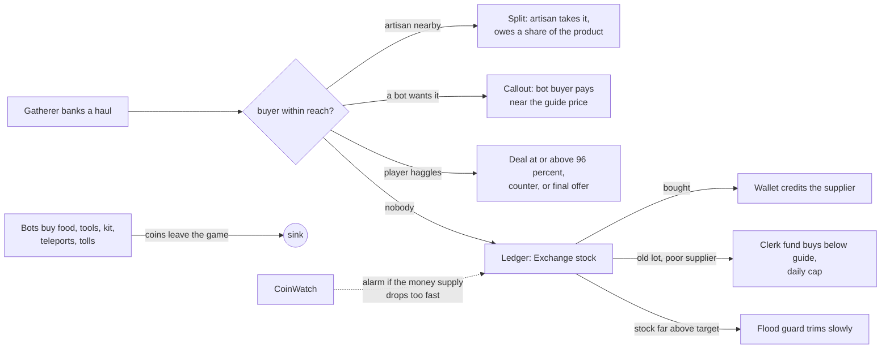

# 2009scape Living World Add-ons

Server add-ons for [2009scape](https://2009scape.org) that fill a private world with bots that play
the way 2009 players did. They gather, craft, trade on the Grand Exchange, haggle in chat, do real
quests, avoid danger, join crews, take breaks and get themselves unstuck. Bots are plain server
classes loaded ahead of an unmodified `server.jar`. No outside AI service, nothing to pay for.

> **Status:** this is a snapshot of the code that ran on my own server in November 2026. I will not
> be able to keep it updated for a while, so I am putting it out as-is for anyone who wants a
> little extra life on their world. Pull requests are welcome; see [CONTRIBUTING.md](CONTRIBUTING.md).
> Not affiliated with or endorsed by Jagex or the 2009scape project.

## Why this exists

I run a small 2009scape server for myself and a couple of friends. The stock bots are fine for
filling a bank queue, but they stand in the same spots, never talk and never go anywhere, and an
empty-feeling world gets old fast when there are three of you online. So I started replacing them:
first bots that walked to real spots and banked, then an economy where what they gathered actually
ended up on the Exchange, then chat, haggling, quests, crews and a watchdog that rescues the ones
that get stuck. The goal was never "more bots"; it was that a friend logging in at 2 AM would see
someone fishing at Catherby, hear someone complain about goblins in Lumbridge, and be able to sell
a stack of ore to a bot standing at the bank.

It grew into about 65 classes. Most of the behaviour came from watching what looked wrong and
fixing that, so it is opinionated and tuned for a low-population server. If that is your
situation too, it should drop straight in.

## What the add-ons do

| Area | What players see | Main classes |
| --- | --- | --- |
| **Smart adventurers** | About 100 bots with goals, shifts, breaks, moods, crews and real gear. They roam, fight, mine, chop, fish, bank, shop on foot and buy upgrades. | `SmartAdventurers`, `AfkTasks` (the trip runner), `BotLife`, `ServiceBots`, `HuntMap`, `Preflight` |
| **Economy** | Gatherers sell hauls to artisans, bot buyers or the Exchange. Prices follow the guide, drift towards shortages and react to bounties. Coins have sinks and caps, so nothing floods or drains. | `Ledger`, `MarketBrain`, `Economy`, `Deals`, `Artisans`, `Bounty`, `PriceDrift`, `BotPrices`, `CoinWatch` |
| **Chat and haggling** | Bots answer directions, prices, quest hints and small talk, haggle over a stack of ore, and chime in on each other. | `BotChat`, `TradeTalk`, `Haggle`, `Bargain`, `PlayerTrades`, `TravellingTraders` |
| **Questing bots** | 17 scripted quests (Cook's Assistant to Shield of Arrav, played by two bots) run through the server's real dialogue, with the server's own rewards. | `QuestRunner`, `QuestScript`, `QuestSteps`, `QuestFloors`, `DialogueDriver`, `Quest*` |
| **Pathing** | Bots learn the map by walking it, remember which crossings fail, respect skill and quest gates, avoid danger, and can use a grid planner. | `RouteMap`, `Gates`, `Heat`, `NavGrid`, `NavPlanner`, `NavWalker`, `Surveyors`, `Explorers`, `Resources` |
| **Shows near players** | Arm-wrestles, dance-offs, boasts and races at hubs, a wave for newcomers, a comment when someone gets rescued. Only where a real player can see it. | `Spectacle`, `Scenes`, `Companions`, `BotRun` |
| **Safety nets** | A watchdog rescues stuck bots, a coin-drain alarm watches the money supply, failures are recorded so a fix can be replayed on the exact trip. | `Watchdog`, `Failures`, `Scenarios`, `EconReplayer`, `SurveyWriter` |
| **Client plugins** (optional) | Quality-of-life plugins for the 2009scape client: borderless fullscreen, minimap zoom, no idle logout, plus adapted community plugins. | `deployment/client-plugins/` |

## How it works

The add-ons are an **overlay**: a folder of classes placed ahead of `server.jar` on the classpath.
Everything hooks in through the server's own `StartupListener` and `Pulse` mechanisms. The jar is
never modified.

### A bot's day

### Where the money goes

The rest of the pictures (job choice, the tick model, chat and haggling, pathing and rescue, the
quest runner) are in [docs/HOW-IT-WORKS.md](docs/HOW-IT-WORKS.md).

## Quick start

1. Build a 2009scape server at the commit in [sources.json](sources.json) (or try your own; the
   overlay replaces two Grand Exchange classes, so a very different server may not match).
2. Compile `deployment/addons-src` against your `server.jar` into a folder called `overlay`.
3. Copy `deployment/seed/data/*` into the server's `data/` folder.
4. Start the server with `overlay` ahead of `server.jar` on the classpath.
5. Watch for `[SmartAdv]`, `[Artisans]` and `[Watchdog]` lines on the console.

Every step with the exact commands and every flag is in [INSTALL.md](INSTALL.md).

## Reading on

* [INSTALL.md](INSTALL.md): build, seed data, flags, client plugins.
* [docs/HOW-IT-WORKS.md](docs/HOW-IT-WORKS.md): the diagrams.
* [docs/bot-behaviour.md](docs/bot-behaviour.md): every behaviour and the flag that controls it.
* [docs/TECHNICAL-REFERENCE.md](docs/TECHNICAL-REFERENCE.md): the long version, class by class.
* [docs/questing-bots.md](docs/questing-bots.md): how the quest scripts work and how to add one.
* [docs/CHANGELOG.md](docs/CHANGELOG.md): what shipped, by month.
* [deployment/tests/README.md](deployment/tests/README.md): the test harness (throwaway worlds on
  `127.0.0.1`, never a live server).

## Credits and license

* [2009scape](https://gitlab.com/2009scape) for the server, the client and the plugin system.
* The adapted client plugins keep their original authors in each `plugin.properties`
  (Ceikry, bushtail, downthecrop, Chisato, Zerken, Edith, ipkpjersi, Pyrethus).
* The add-ons compile against and replace 2009scape classes, so they are released under the same
  license: [GNU AGPL v3](LICENSE).
