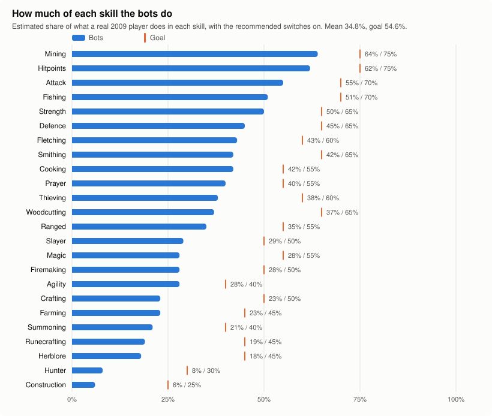
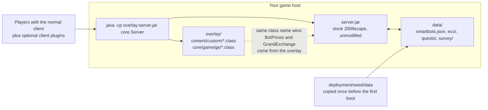
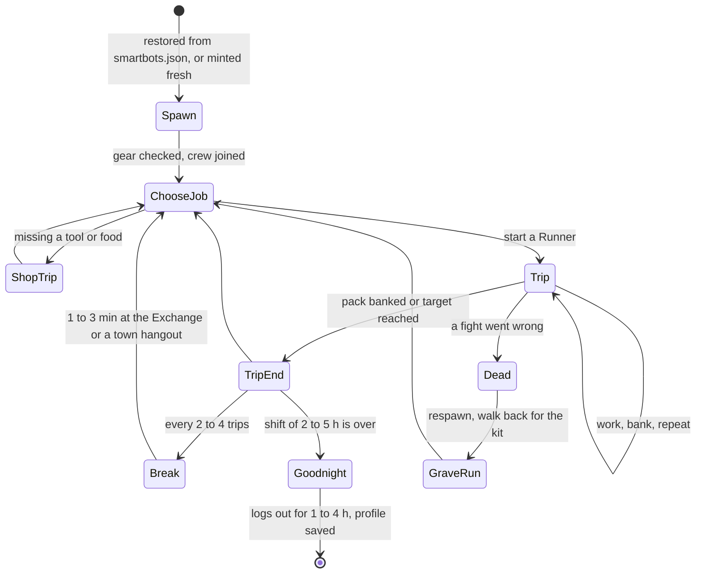
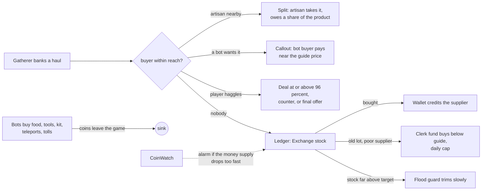

# 2009scape Living World Add-ons

Server add-ons for [2009scape](https://2009scape.org) that fill a private world with about 100 bots that
play the way 2009 players did. They train every skill from Attack to Summoning, take Slayer tasks from
four masters, run farm and herb loops, gather, craft, trade on the Grand Exchange, haggle in chat, do real
quests, avoid danger, join crews, take breaks and get themselves unstuck. Bots are plain server classes
loaded ahead of an unmodified `server.jar`. No outside AI service, nothing to pay for.

> **Status (November 2026):** the newer behaviour is behind switches that are off by default, so a
> fresh install starts quiet; turn on the recommended set (below) to get everything on this page.
> Pull requests are welcome, see [CONTRIBUTING.md](CONTRIBUTING.md). Not affiliated with or endorsed by Jagex or the 2009scape project.

## What's new (November 2026)

The big change: bots now **train skills the way players do**, not just gather and fight. Every new
behaviour sits behind its own switch and is off by default. Each was tested in paired runs (switch on
and off) and scripted scenarios before being added to the recommended set:
[deployment/recommended-flags.txt](deployment/recommended-flags.txt) lists those 83 switches, with a
one-line command to pass them all.

<picture>
  <source media="(prefers-color-scheme: dark)" srcset="docs/img/skills-vs-target-dark.svg">
  
</picture>

How to read it: for each skill, roughly how much of what a real 2009 player does there the bots do
with the recommended switches on, judged from a day of server logs (only behaviour seen happening
counts). It is an estimate, not a measurement. The orange mark is the goal for each skill; the gap is
the work still to come.

Highlights, by area (full list in [docs/CHANGELOG.md](docs/CHANGELOG.md)):

* **Combat skills:** stance plans and a Defence share, weapons chosen for the monster, special attack
  weapons, amulets and armour above rune, a melee fallback for rangers, safe retreats when a fight goes
  wrong, cheaper food.
* **Slayer:** Turael and Vannaka, plus Chaeldar and Duradel (off and not in the recommended set yet;
  turn on `bots.slayer.chaeldar` and `bots.slayer.duradel` to try them), with points, banking first, tasks that fit the
  bot's purse, and fixes for the bats, ice giants and the Vannaka door.
* **Summoning:** Wolf Whistle, pouches, healing and combat familiars, and the beast of burden (bots use it from Summoning 13).
* **Gathering:** Mining and Fishing Guilds, sharks, power mining, tree and herb farm runs, Hunter
  (birds), Barbarian agility laps, Ardougne pickpocketing, nature and law rune runs.
* **Artisan skills:** smiths smelt their own bars, fletchers make arrows and their own bows, cooks burn
  less and cook on fires, plank types for Construction, enchanting and High Alchemy.
* **Economy safety:** a clerk with a daily budget, a boot-time fair, and a coin watch that knows the
  normal hourly swing and ignores boot-time sea crossings, so the new spending does not drain the
  bots' coins unnoticed.

## What the add-ons do

| Area | What players see | Main classes |
| --- | --- | --- |
| **Smart adventurers** | About 100 bots with goals, shifts, breaks, moods, crews and real gear. They roam, fight, mine, chop, fish, bank, shop on foot and buy upgrades. | `SmartAdventurers`, `AfkTasks` (the trip runner), `BotLife`, `ServiceBots`, `HuntMap`, `Preflight` |
| **Skill training** (new) | Bots spread their time across skills, move up to better training spots, use guilds, and train Summoning, Farming, Hunter, Thieving, Agility, Runecrafting, Construction, Magic and Prayer. | `W5aSkills` to `W37Craft`, `Artisans`, `MineGuild`, `RcRun`, `Bob`, `Batch29` |
| **Slayer** (new) | Up to four masters, real task lists, points, banking and a trip home. | `Slayer`, `W9Chaeldar`, `W13Duradel`, `HuntMap` |
| **Economy** | Gatherers sell hauls to artisans, bot buyers or the Exchange. Prices follow the guide, drift towards shortages and react to bounties. Coins have sinks and caps, so nothing floods or drains. | `Ledger`, `MarketBrain`, `Economy`, `Deals`, `Artisans`, `Bounty`, `PriceDrift`, `BotPrices`, `CoinWatch` |
| **Chat and haggling** | Bots answer directions, prices, quest hints and small talk, haggle over a stack of ore, and chime in on each other. | `BotChat`, `TradeTalk`, `Haggle`, `Bargain`, `PlayerTrades`, `TravellingTraders` |
| **Questing bots** | 17 scripted quests (Cook's Assistant to Shield of Arrav) run through the server's real dialogue, with the server's own rewards. | `QuestRunner`, `QuestScript`, `QuestSteps`, `QuestFloors`, `DialogueDriver`, `Quest*` |
| **Pathing** | Bots learn the map by walking it, remember which crossings fail, respect skill and quest gates, avoid danger, and can use a grid planner. | `RouteMap`, `Gates`, `Heat`, `NavGrid`, `NavPlanner`, `NavWalker`, `Surveyors`, `Explorers`, `Resources` |
| **Shows near players** | Arm-wrestles, dance-offs, boasts and races at hubs, a wave for newcomers, a comment when someone gets rescued. Only where a real player can see it. | `Spectacle`, `Scenes`, `Companions`, `BotRun` |
| **Safety nets** | A watchdog rescues stuck bots, a coin-drain alarm watches the money supply, failures are recorded so a fix can be replayed on the exact trip. | `Watchdog`, `Failures`, `Scenarios`, `EconReplayer`, `SurveyWriter` |
| **Client plugins** (optional) | Quality-of-life plugins for the 2009scape client: borderless fullscreen, minimap zoom, no idle logout, plus adapted community plugins. | `deployment/client-plugins/` |

## How it works

The add-ons are an **overlay**: a folder of classes placed ahead of `server.jar` on the classpath.
Everything hooks in through the server's own `StartupListener` and `Pulse` mechanisms. The jar is
never modified.

### A bot's day

### Where the money goes

The rest of the pictures (job choice, the tick model, chat and haggling, pathing and rescue, the
quest runner) are in [docs/HOW-IT-WORKS.md](docs/HOW-IT-WORKS.md).

## Quick start

1. Build a 2009scape server at the commit in [sources.json](sources.json) (or try your own; the
   overlay replaces two Grand Exchange classes, so a very different server may not match).
2. Compile `deployment/addons-src` against your `server.jar` into a folder called `overlay`.
3. Copy `deployment/seed/data/*` into the server's `data/` folder.
4. Start the server with `overlay` ahead of `server.jar` on the classpath.
5. Watch for `[SmartAdv]`, `[Artisans]` and `[Watchdog]` lines on the console.
6. Optional: turn on the skill and Slayer behaviour with the switches in
   [deployment/recommended-flags.txt](deployment/recommended-flags.txt) (all off by default).

Every step with the exact commands and every flag is in [INSTALL.md](INSTALL.md).

## Reading on

* [INSTALL.md](INSTALL.md): build, seed data, flags, client plugins.
* [docs/HOW-IT-WORKS.md](docs/HOW-IT-WORKS.md): the diagrams.
* [docs/bot-behaviour.md](docs/bot-behaviour.md): every behaviour and the flag that controls it.
* [docs/TECHNICAL-REFERENCE.md](docs/TECHNICAL-REFERENCE.md): the long version, class by class.
* [docs/questing-bots.md](docs/questing-bots.md): how the quest scripts work and how to add one.
* [docs/CHANGELOG.md](docs/CHANGELOG.md): what shipped, by month.
* [deployment/recommended-flags.txt](deployment/recommended-flags.txt): the recommended feature switches.
* [deployment/tests/README.md](deployment/tests/README.md): the test harness (throwaway worlds on
  `127.0.0.1`, never a live server).

## Credits and license

* [2009scape](https://gitlab.com/2009scape) for the server, the client and the plugin system.
* The adapted client plugins keep their original authors in each `plugin.properties`
  (Ceikry, bushtail, downthecrop, Chisato, Zerken, Edith, ipkpjersi, Pyrethus).
* The add-ons compile against and replace 2009scape classes, so they are released under the same
  license: [GNU AGPL v3](LICENSE).
