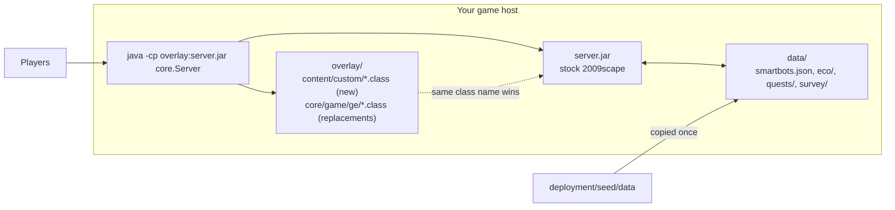
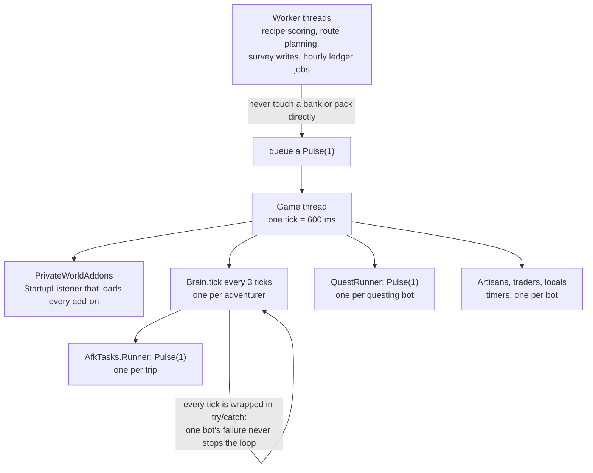
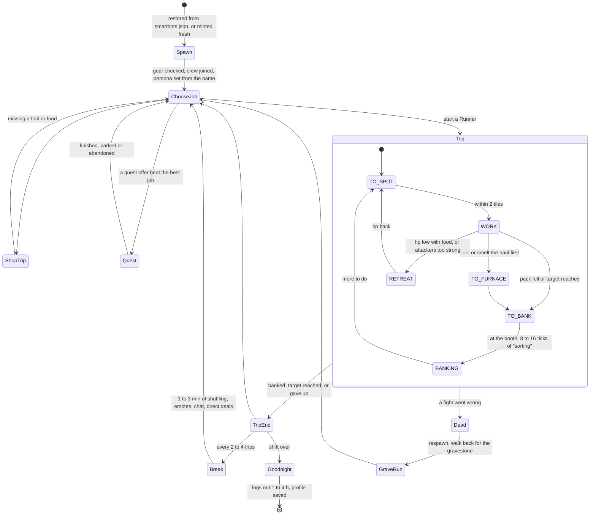
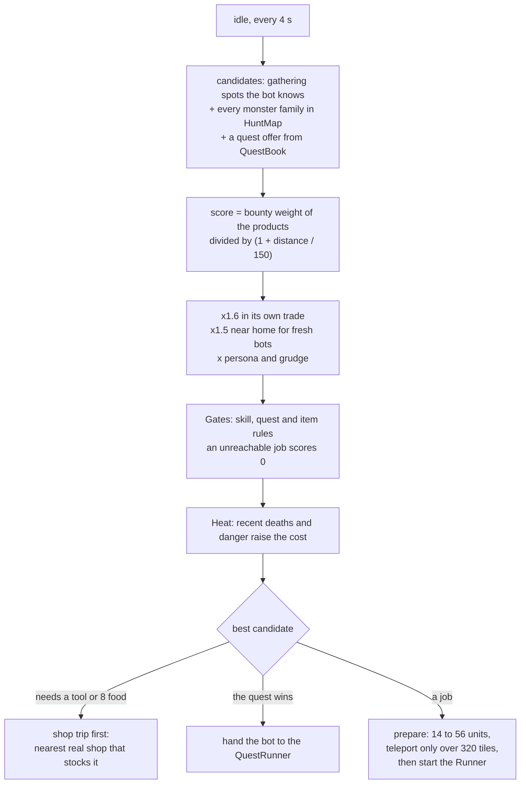
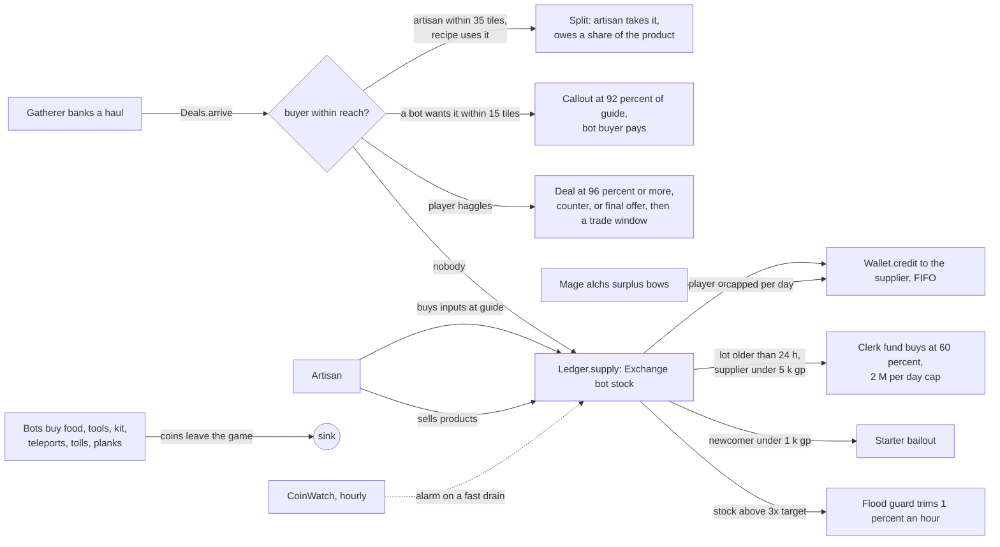
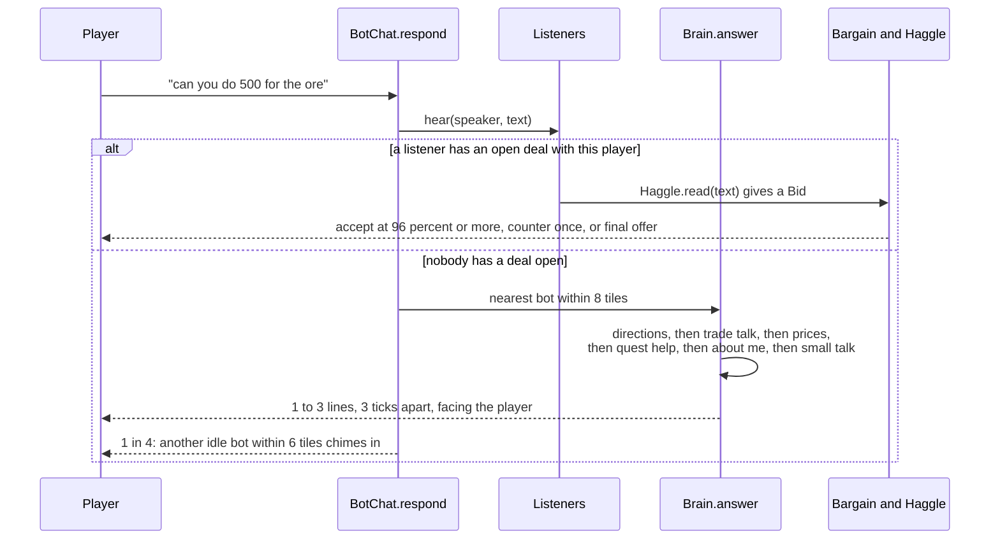
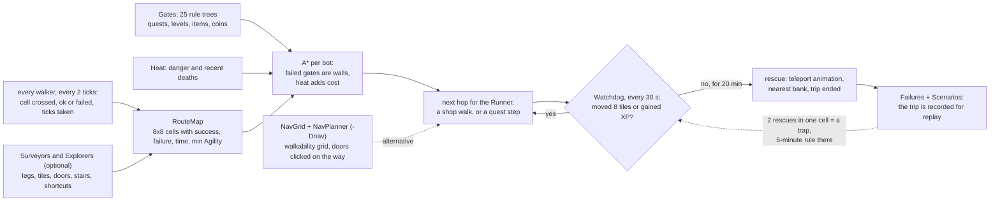
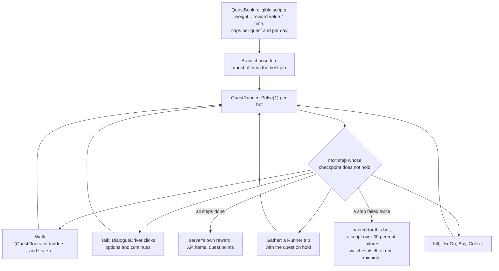

# How it works

Seven pictures of the moving parts. The class names are the ones in `deployment/addons-src/content/custom/`;
the long version of each is in [TECHNICAL-REFERENCE.md](TECHNICAL-REFERENCE.md).

## 1. The overlay

The add-ons are compiled into an `overlay/` folder that sits ahead of `server.jar` on the classpath.
Java loads the first class it finds under a name, so the two `core.game.ge` classes in the overlay
replace the server's own, and everything else is new classes the server's `ClassScanner` picks up
because they implement `StartupListener`. The jar itself is untouched.

## 2. Ticks, pulses and threads

The server runs one game tick every 600 ms on a single game thread. The add-ons never change a
bank, a pack or the world from another thread: slow work (scoring 470 recipes, planning a route,
writing survey files) runs on worker threads and hands its result back by queueing a `Pulse(1)`,
which the game thread runs next tick.

## 3. A bot's day

Each smart adventurer is a `Brain`. Between trips it decides what to do next; during a trip a
`Runner` drives it; every few trips it takes a break at the Exchange or a town hangout; after a
shift of two to five hours it says goodnight and logs out for a while, and comes back under the same
name with the same bank.

## 4. Choosing a job

Every few seconds an idle bot scores every job it knows about. The score comes from the market
(what is short and worth a bounty), scaled by distance, its own trade, where it lives and what it
holds a grudge against. Jobs it cannot reach because of a skill, quest or item gate score nothing.

## 5. Where the money goes

Coins only enter the game by selling something. A haul is offered to an artisan nearby first, then
to any bot that wants it, then to a haggling player, and only then goes on the Exchange as bot
stock where the Ledger remembers who supplied it and pays them when it sells. Coins leave through
food, tools, kit, teleports and tolls. `CoinWatch` raises an alarm if the total drops too fast.

## 6. Chat and haggling

Every public line a human types near a bot goes through one funnel. Listeners with an open deal
get first pick (a trader mid-haggle, a callout, a buy window). Otherwise the nearest bot answers
from a fixed order of understanding, and one time in four another idle bot chimes in. Prices are
read out of anything a 2009 player might type: "can you do 500", "500 each", "half", "deal".

## 7. Finding the way, and getting rescued

Bots walk on a learned route map: every walker reports the cells it crossed and whether it got
through, so the map fills in from real trips (a seed map is included). `Gates` holds the
"you need X to be here" rules, `Heat` adds cost where bots have died. An optional grid planner
(`NavPlanner`) can take over hop by hop. When all of that fails, the `Watchdog` notices a bot that
has not moved or gained XP in 20 minutes and teleports it to the nearest bank, and the failure is
written down so the exact trip can be replayed against a fix.

## 8. The quest runner

A quest is a list of steps (walk, talk, use, gather, kill, buy, climb) in `QuestScript`. The
`QuestRunner` re-reads the server's real quest stage every tick and skips steps whose checkpoint
already holds, so a bot can resume a half-done quest after a restart. Dialogue is clicked through
the way a client would (`DialogueDriver`), so the server grants the real reward.

