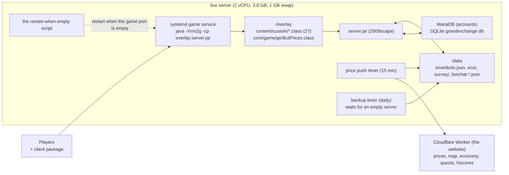
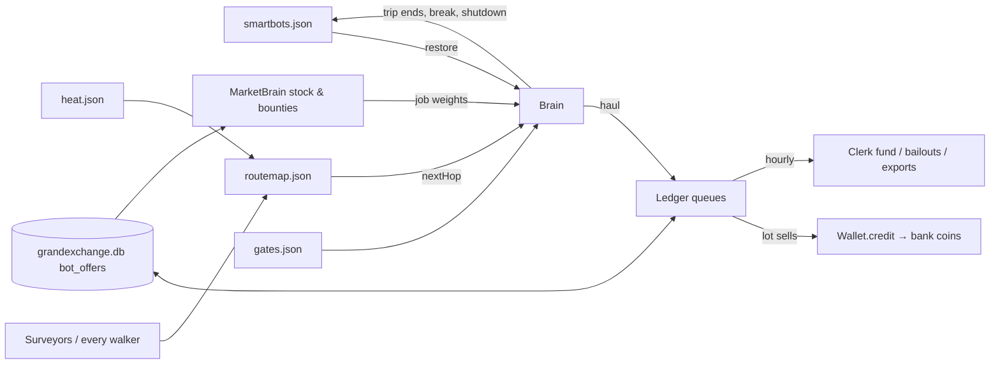
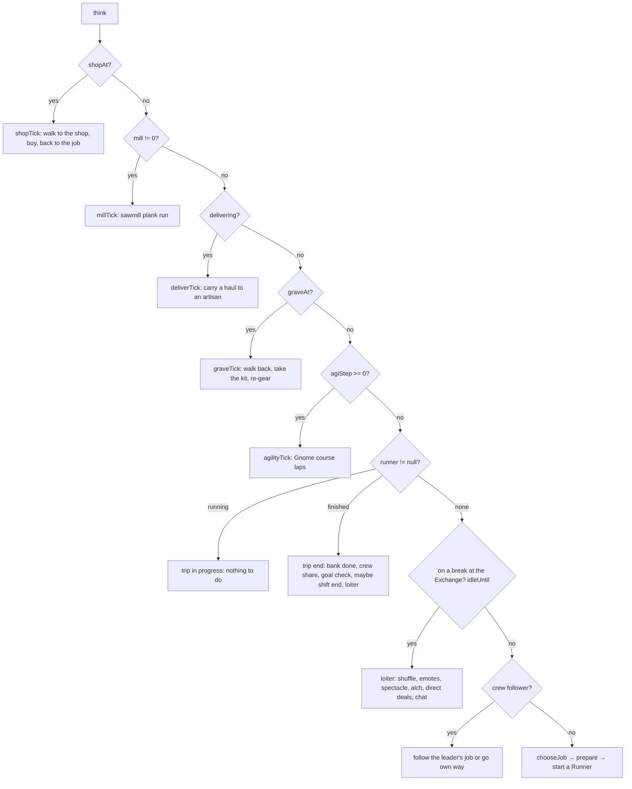
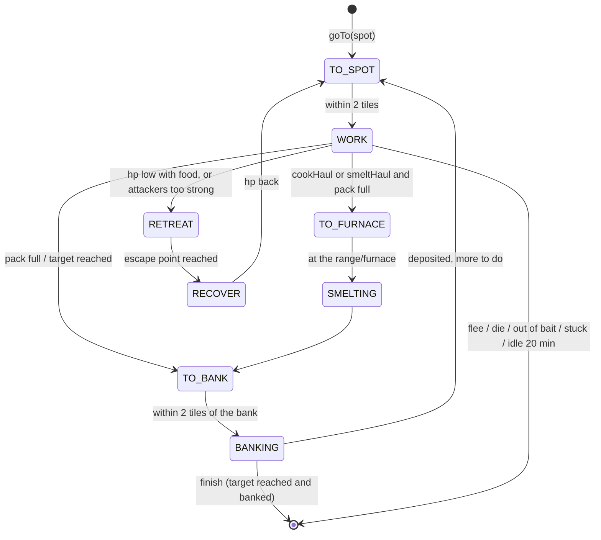
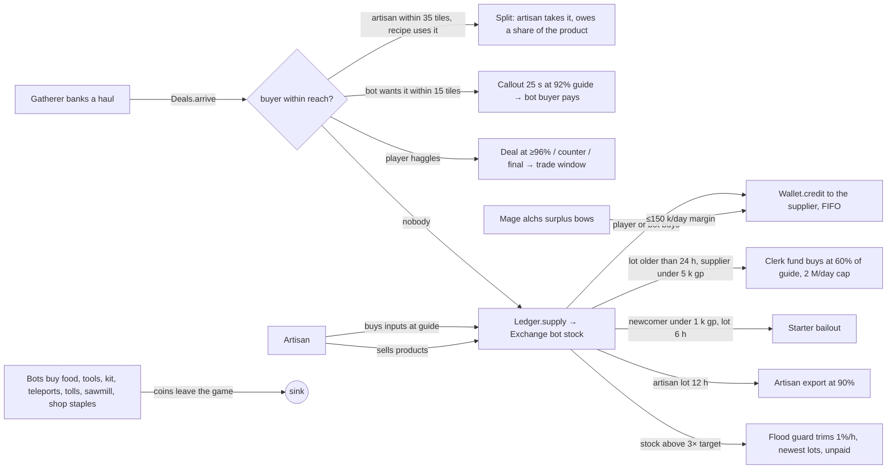
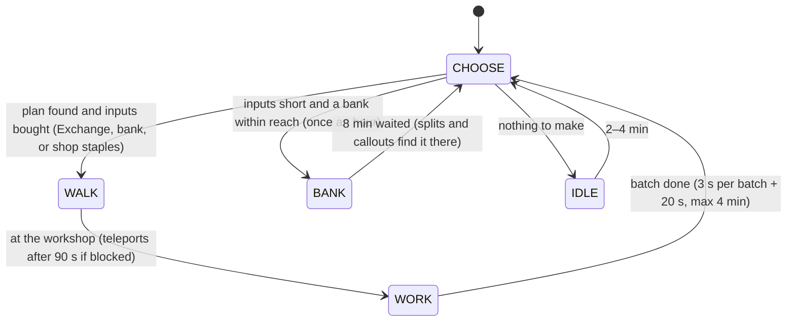
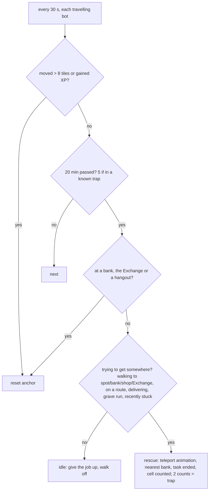
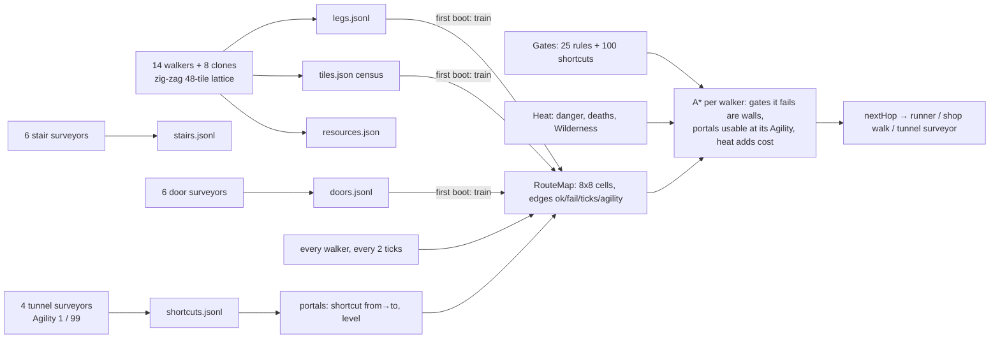

# Technical reference

> Read the [README](../README.md) and [HOW-IT-WORKS.md](HOW-IT-WORKS.md) first. Everything here is read from the source in `deployment/addons-src/`.

Written in October 2026 from the code as it ran on the owner's live server (sections 1 to 15). What shipped after that is condensed in [CHANGELOG.md](CHANGELOG.md); the newer classes (`Bargain`, `AfkMagic`, `Scenes`, `CoinWatch`, `Preflight`, `Failures`, `Scenarios`) have their design in their class comments.

Repo root: the project folder (`<repo>` below). "The live server" is the owner's single Linux box; "the website" was a separate price and map site that is not part of this repo.

---

## 1. System overview

The world is a stock 2009scape server (Java 11, Kotlin content) with an **overlay** of add-on classes that load ahead of the server jar and populate it with about 170 bots that behave like 2009 players. The add-ons never patch the server; they use its public plugin points (`StartupListener`, `ShutdownListener`, `Pulse`, `Script`, the AI player and Grand Exchange APIs) and one shadowed class (`core.game.ge.BotPrices`).



**Populations (live config):** 90 smart adventurers + 12 high tier (`smartbots.count`/`smartbots.high`), 11 artisans, 4 travelling traders, 8 town locals, 1 herb gatherer, 1 fish sweeper (a scheduler, not a bot), 14 walking surveyors + 8 clones, 6 stair + 6 door + 4 tunnel surveyors. The server's own "dumb" adventurer bots are off (`max_adv_bots = 0` since 21:04).

**Three rules every bot follows** (`docs/bot-behaviour.md` §0): coins only come from selling something (plus the bounded clerk fund, starter bailouts and now High Alchemy, all capped); bots avoid deaths they can see coming and lose what a player loses; if a player can watch it, it should look like a person.

---

## 2. Codebase structure

All sources: `deployment/addons-src/content/custom/` (package `content.custom`), plus `deployment/addons-src/core/game/ge/BotPrices.java`. 13,190 lines in 27 files.

| File | Lines | Role | Key entry points |
|---|---|---|---|
| `SmartAdventurers.java` | 2,547 | The adventurers: profiles, spawning/restore, `Brain` (think loop, jobs, trips, shops, goals, crews, breaks, graves, Agility, stars, plank runs, deliveries, alching), shutdown save | `startup()`, `Brain.think()`, `Brain.chooseJob()`, `restore()`, `logOut()`, `shutdown()` |
| `AfkTasks.java` | 1,943 | The task runner every gatherer and fighter uses (also the players' `::afk`): walk, gather/fight, cook/smelt, bank, deposit, flee, teleports, bridges, tolls, dungeon entrances | `Runner.pulse()`, `work()`, `fight()`, `walk()`, `goTo()`, `deposit()`, `flee()` |
| `BotChat.java` | 1,404 | Everything bots say and hear: answers, ambient lines, banter, chime-ins, gossip, gz, memory of players, trust, speech delivery, world data for directions | `respond()`, `Brain.answer()`, `ambient()`, `say()`, `speak()` |
| `TradeTalk.java` | 369 | Trade and everyday questions (what do you buy/sell/pay, where to mine, training tips, goals, news, requirements) | `trade()`, `everyday()`, `resolve()` |
| `Haggle.java` | 239 | One price reader for every haggling bot | `Haggle.read(text, lotQty)`, `Bid.total()` |
| `Deals.java` | 564 | Bank callouts (60 s), splits to artisans, errands/meets, player haggling at callouts, selling on request | `arrive()`, `tick()`, `humanTrade()`, `heard()`, `haggle()`, `sellOnRequest()` |
| `PlayerTrades.java` | 334 | Idle bots buying what they use from players through the trade window, with haggling | `tick()`, `session()`, `want()`, `heard()`, `ask()` |
| `Ledger.java` | 445 | FIFO ledger of who supplied what to the Exchange, wallets (bank coins), credits, clerk fund, write-offs, trims, alch cap, atomic saves | `supply()`, `consume()`, `clerkRound()`, `Wallet.credit/give/pay/restore` |
| `MarketBrain.java` | 408 | Stock snapshot, targets, bounties, surplus, demand, flood guard, hourly ledger round | `refresh()`, `bounty()`, `isSurplus()`, `takeFromStock()` |
| `Artisans.java` | 518 | 11 craftsmen with real levels: choose a recipe, buy inputs, work, sell; bank waits; shop staples | `Artisan.tick()`, `choose()`, `buyInputs()` |
| `TravellingTraders.java` | 722 | 4 traders: gather for real, find a player, pitch, haggle, trade, stash | `Trader.tick()`, `gather()`, `seek()`, `pitch()`, `trading()`, `haggler` |
| `BotLife.java` | 377 | Town locals, herb gatherer, fish sweeper | `startup()`, `Local.tick()`, `HerbGatherer.tick()` |
| `ServiceBots.java` | 87 | Saved names/gear/banks for traders, locals, herb gatherer | `make()`, `saveAll()` |
| `Spectacle.java` | 320 | Arm wrestles, dance-offs, boasts, follow-the-leader, races, side bets, human challenges | `tick()`, `tripDone()`, `maybeRace()`, `heard()` |
| `Watchdog.java` | 221 | Stuck-bot rescue, traps, idle give-up | `tick()`, `trying()`, `rescue()`, `idle()` |
| `RouteMap.java` | 444 | Learning route map: 8x8 cells, edges, A*, next hop, portals (shortcuts) | `plan()`, `nextHop()`, `stuck()`, `sample()`, `portal()` |
| `Gates.java` | 500 | Requirement rules (quests, skills, keys, tolls), shortcut catalogue, seeded quest logs | `canEnter()`, `cellBlocked()`, `seedQuests()`, `scanRegion()` |
| `Heat.java` | 114 | Danger/death/Wilderness heat per cell; `heat.json` for the website | `extra()`, `rebuild()`, `save()` |
| `Resources.java` | 136 | Where rocks, trees, fishing spots, monsters, banks are (from surveyors) | `scan()`, `nearest()`, `nearestMatching()` |
| `Surveyors.java` | 292 | Walking surveyors: legs, tile census, resources | `Surveyor.tick()`, `plan()`, `flush()` |
| `Explorers.java` | 395 | Stair, door and tunnel surveyors | `Explorer.tick()`, `Tunneller.tick()` |
| `HuntMap.java` | 144 | Monster hunts built from drop tables and spawns | static init, `HUNTS`, `CURATED` |
| `Bounty.java` | 168 | Player bounty board (`::market`), crier rallies | `startup()`, `playerSold()`, `board()` |
| `PriceDrift.java` | 113 | Slow price drift toward shortages/gluts | `drift()` |
| `Economy.java` | 161 | 10-minute snapshot for the website; pays real players their waiting credits | `write()` |
| `PrivateWorldAddons.java` | 163 | Boot glue: the `::afk` command, misc | `startup()` |
| `Announcer.java` | 62 | Announcements from `announce.txt`, repeated 3x | `startup()` |
| `core/game/ge/BotPrices.java` | | Shadows the server's class so bot prices equal the guide price | |

Supporting data in the same folder: `artisan-recipes.json` (472 recipes; fields `trade`, `product`, `productName`, `amount`, `level`, `inputs[{id,name,amount}]`).

### Build and deploy
See [INSTALL.md](../INSTALL.md): compile `deployment/addons-src` against your `server.jar`, copy `artisan-recipes.json` next to the classes, and start the server with the overlay folder ahead of `server.jar` on the classpath. Classes are read at startup, so a change needs a restart.

---

## 3. Runtime model: ticks, pulses and threads

- The game loop ticks every **600 ms**. Add-ons schedule work as `Pulse(n)` objects (run every `n` ticks on the game thread) or as `java.util.Timer` tasks (off the game thread; anything that touches a player's bank or inventory is then queued back as a `Pulse(1)`, audit #1).
- `PulseRunner` logs any pulse over ~30 ms as "Long running pulse" and over ~100 ms as "CRITICALLY long"; today's steady rate is 630–1,220 such lines an hour, almost all `AfkTasks$Runner` scans.
- Every bot `Script` is ticked by the server's `BotScriptPulse` only while the bot has no pulse of its own; the adventurers therefore have their **own heartbeat** `Pulse(3)` that calls `Brain.tick()` regardless (otherwise a bot still fishing after its trip "finished" never thinks again).

| Cadence | What runs |
|---|---|
| every tick | `PlayerTrades.tick` (open trade windows), `AfkTasks.Runner` (one per active trip, `Pulse(1)`) |
| every 2 ticks | `Deals.tick` (callouts, meets, errands), `RouteMap.sample` (learns from every walker), `Gates` region scan at boot |
| every 3 ticks | `Brain.tick` heartbeat → `think()` (throttled by `nextThink`) |
| every 50 ticks (30 s) | `Watchdog.tick` |
| every 100 ticks (60 s) | `Economy` pays real players their waiting Exchange credits |
| 25–60 s | `BotChat.ambient` (one bot speaks to one nearby human) |
| 60–180 s | `BotChat` bot-to-bot banter near a human |
| 5 min | `MarketBrain.refresh` (stock, targets, bounties, surplus), bounty board |
| 10 min | `Economy.write` snapshot (first after 5 min); `Heat` rebuild and save; `Gates` save; `Surveyors.flush` legs; `Resources.save`; `BotChat.Memory` save (5 min) |
| hourly | `MarketBrain` ledger round (first after 2 min): flood guard trim, `Ledger.clerkRound` (clerk fund, starter bailouts, artisan exports, dead-credit write-off), `Ledger.save`; `PriceDrift.drift` (first after 20 min) |
| 15 min | systemd the price-push timer → `push-prices.py` → Cloudflare |
| daily (a quiet hour) | the backup timer (waits up to 50 min for an empty server, else backs up hot) |

---

## 4. Data files and persistence

| File | Written by | When | Holds |
|---|---|---|---|
| `data/smartbots.json` | `SmartAdventurers.saveProfiles` | on a timer, at every break log-out and at shutdown | every adventurer: name, levels, exact XP (24 doubles), gear ids, coins, pack, bank, ammo id+count, favourite skill, goal, home town, high/veteran flags, catchphrase, grudge, `backAt` for bots on a break |
| `data/eco/ledger.json` | `Ledger.save` | hourly, shutdown | FIFO queues per item (supplier, qty, time), daily caps by day (`caps`, §20.3), `offline` credits by name, counters (earned, spent, paid, given, credited, restored, writtenOff, alched), clerk day/paid |
| `data/eco/artisans.json` | `Artisans.saveAll` | shutdown | each artisan's name, trade, levels, bank, coins |
| `data/eco/servicebots.json` | `ServiceBots.saveAll` | shutdown | traders, locals, herb gatherer by role key: name, gear, bank, coins |
| `data/eco/economy.json` | `Economy.write` | 10 min | the website snapshot (§10) |
| `data/eco/traps3.json` | `Watchdog.save` | on each rescue | cell → rescue count (≥2 = trap) |
| `data/eco/price-base.json` | `PriceDrift` | on new base | base guide prices for the 70–150% band |
| `data/eco/grandexchange.db` | the server | continuous | `bot_offers` (bot stock), `player_offers`, `price_index` |
| `data/eco/stock-history/*.json` | `MarketBrain` | hourly | stock snapshots for the website |
| `data/survey/legs.jsonl` | `Surveyors.flush` | 10 min | every surveyor leg: from, to, result, agility; rotated weekly into `legs-YYYY-Www.jsonl.gz` (4 kept) from batch 17 |
| `data/survey/tiles.json` | `Surveyors` | 10 min | tile visit census (38,683 tiles) |
| `data/survey/stairs.jsonl`, `doors.jsonl`, `shortcuts.jsonl` | `Explorers` | per test | object, option, from, to, result |
| `data/survey/routemap.json` | `RouteMap.save` | on a timer and at shutdown | edges (ok/fail/ticks/agility), best tile per cell, locked doors |
| `data/survey/gates.json` | `Gates.save` | 10 min | shortcut catalogue with test results, shut doors, scanned regions, gate confirmations |
| `data/survey/heat.json` | `Heat.save` | 10 min | per cell: traffic, danger, deaths, Wilderness, gates, resources; all shortcuts |
| `data/survey/resources.json` | `Resources.save` | 10 min | "kind:name" → cell → sightings |
| `data/botchat-memory.json`, `botchat-trust.json` | `BotChat` | 5 min, shutdown | per player: visits, first/last seen, last topic; trust per bot–player pair |
| `data/announce.txt` | restart scripts | before a restart | the announcement the `Announcer` repeats 3x |
| `data/metrics.json` | `Economy` | 10 min | private ops metrics and the "doubled" alert counters (§20.5); not published |
| `data/eco/last-save.json` | `SmartAdventurers.writeLastSave` | after each real smartbots.json save | bot count and coin total, read by the startup sanity check (§20.2) |

`Ledger.writeAtomic` writes `name.tmp` then moves it (fallbacks for filesystems without atomic move), so a crash mid-save never leaves half a file.

**Shutdown order** (`SmartAdventurers.shutdown`, a `ShutdownListener`): graves reclaimed into banks → `Deals.settleForShutdown` (splits paid, requested sales kept) → `TravellingTraders.stashForShutdown` (hauls to the Exchange via the ledger) → artisans saved → service bots saved → route map and resources saved → profiles saved → ledger saved → chat memory and trust saved → "saved everything for shutdown".

**Restore order** (startup): profiles loaded (`KNOWN_NAMES`), high tier first then adventurers, each recreated with its own name where possible (else `Ledger.rename` moves lots and credits), levels and XP set, pack/bank/ammo put back (`restoreItems` before wearing gear), coins restored via `Wallet.restore` (not counted as new money), quest log seeded from levels, enlisted with a fresh `Brain`.



---

## 5. Smart adventurers (`SmartAdventurers.java`)

### 5.1 Who they are
- **Fresh** (67): start with 600 gp and bronze, home town from eight (`BotLife.Town`), levels grow by doing; **veterans** (23): 20–60 k gp nest egg once, mid levels; **high tier** (12): combat 107–114, 120–250 k gp once, Dragon Slayer and the other big quests seeded, dusty key.
- **Style** from a hash of the name (`styleFor`): under 18 ranger, under 35 mage, else melee; fighters only. Rangers carry bows and 200 arrows; mages a staff of fire and runes; autocast picks wind strike / fire strike / fire bolt / fire blast by Magic level.
- **Trade** (`fav`): the gathering skill it leans to (score x1.6 for jobs in its trade).
- **Persona** (`BotChat.Persona.of`): cheery, gruff, posh, dreamy, salty from the name; a catchphrase and a grudge (`STORY`).
- Real Agility seeded by tier (`seedAgility`); real quest log seeded from levels (`Gates.seedQuests`, deterministic per name).

### 5.2 The think loop
`Brain.tick()` runs every 3 ticks; `think()` returns at once unless `now >= nextThink`. Order inside `think()`:



**Timings**
- Between trips: `nextThink = now + 20–60 s` (5 s in trials).
- Shift: 2–5 h from the Brain's creation (`shiftEnd`); last quarter of it the mood reads **tired**.
- Break: at a trip's end past `shiftEnd` (checked before shop and plank errands since 19:44), or if still about 30 min past the shift with nothing running: says goodnight, `logOut()` → profile to `OFFLINE`, bot cleared, back after **1–4 h** (`backAt`), restored by name. At most 40% of the count may be away at once.
- Loiter: every 2–4 trips (`sinceLoiter`), at the nearest hangout of 12 (Lumbridge courtyard, Varrock fountain, Falador park, Rising Sun, Draynor market, Port Sarim docks, Catherby beach, Edgeville well, Al Kharid gardens, Seers' bank, Barbarian fire, Ardougne market) or the Exchange; emotes by mood every few ticks (1 in 4), shows (§9), alching (§5.8), direct deals, idle lines every 40 s (1 in 4).

### 5.3 Choosing a job (`chooseJob`)
175 jobs: every gathering `AfkTasks.Task` with products and a known spot, plus 130-odd `HuntMap` hunts (monster families with their densest surface spawn or a curated dungeon spot).

For each job, in order:
1. `jobWeight`: the market bounty of its best product (hunts: sum of bounty x drop chance x1.5 x popularity, classic monsters x3). Weight 0 skips the job unless the bot is **broke** and the job pays coins on the spot (pickpocketing).
2. Hard gates: dragons need an anti-dragon shield; poisonous monsters need combat 70; `deadlyFor` (banshees without earmuffs, snails/zogres/crawling hands under combat 60); two bot deaths at the spot today; the bot's own 24-h blacklist after dying there; skill or combat level (`effectiveCombat = min(combat, Defence + 25)`); magic-using monsters need `npcLevel x2 + 10`; level 80+ monsters need Prayer 43 and a shield; `Gates.canEnter` for the spot (quest/skill/key/toll).
3. Capacity: bots already on that task/hunt (`crowd`) plus the crew size must fit (`capacity`: 1 runite rock, 2 adamant/mithril/gold/silver, 6 coal/iron, 4 default; hunts `spawns/3` capped 4).
4. Score: `weight / (1 + distance/150) x (0.8–1.2 random)`, halved if it was the last job, divided by `1 + crowd`. **Broke mode** instead scores expected coins per trip (20 units of the best product; hunts 15 kills x drop EV; pickpocketing counts double).
5. Multipliers (not broke): x1.6 own trade; x1.5 within 180 tiles of home for fresh bots; x1.4 grudge monsters; x1.5 fighting for a crew leader; high tier x3 for level 80+ monsters, x1.5 for 40+, x0.2 for low-level work; x1.25 per artisan shortage of the product (max x2).

### 5.4 Preparing a trip (`start`/`prepare`)
- Tools from the bank, else bought: at the Exchange if nearby and stocked, otherwise a **shop trip** (`shopAt`) to the real shop from the map's shop list (Bob's Axes, Gerrant's, Wydin's, Ali's, Zeke's, Louie's, Horvik, Cassie's...). Arrival counts within 5 tiles, or 9 with two stalls. Deadline 8 min; past it the item is bought "elsewhere" (coins leave the game) and the trip goes on. Walks aim at the most-walked tile within 3 of the shop; a line across the River Lum goes via the bridge (3242,3226).
- Food for fights and thieving: `buyFood(npcLevel)` carries `clamp(10..20, level/8)`: 10 for small things, 20 for demons and giants. Bought from the Exchange if there and stocked, else a shop.
- Bait/feathers for bait and fly fishing: `tripMax + 24` (80), from the bank first.
- Prayer potions for level 60+ hunts (high tier), bought at the Exchange when there.
- Armour trips (`armourNeeds`) buy matched sets at armour shops; the bot pays guide and wears it (`wear()` fires the equipment listener so bonuses, speed and appearance apply).
- Then `AfkTasks.Runner` is created: `goTo(TO_SPOT, spot)`.

### 5.5 Trip end
`runner` finished → `trips++`, Spectacle `tripDone` (races), a "done" line 1 in 3, news if 12+ collected, mood **chatty** 10 min if 20+, armour/exchange flags reset, goal re-pick every second trip when none, `checkGoal` (buys the goal when affordable; if the Exchange has none, a shop trip to the goal's shop), crew share-out (a leader gives part of its earnings to broke members), shift check → break, plank run (`planPlankRun`, 1 in 5, builders only), loiter.

### 5.6 Goals (`GOALS`, `pickGoal`, `checkGoal`)
Items a 2009 player saved for, each with a level: rune scimitar/full helm/platebody/legs/kite (40), rune plateskirt (Seddus), dragon scimitar/dagger/longsword and berserker helm (quest gear: high tier only), glory, obsidian cape, whip (70), adamant and mithril scimitars/platebodies/legs/helms/kites (20–30), green d'hide body (Ranged 40), magic shortbow (50), amulet of power. A goal must be **obtainable**: Exchange stock > 0 or a real shop sells it (`goalShop` from map-data), with the price between the bot's coins and 40x its coins (min 20 k). Picked at spawn and re-picked every second trip while none.

### 5.7 Crews
A leader (veteran or high tier, 1 in N) announces a job; nearby bots of a matching tier (`tierOf`) join (`able(job)` must hold), follow within 3 min of the call, stop waiting if the leader is busy, share out at trip end; the crew winds down with its leader's shift.

### 5.8 Breaks: what happens at the Exchange
Loitering bots: random shuffles (1 in 3), mood emotes (1 in 4: yawns when tired, cheers when chatty, etc.), **Spectacle** shows (§9), **High Alchemy** (1 in 6 per think, bots with Magic 55+, at most once per 10 min: 10 surplus bows + 10 nature runes bought through the ledger, alched for the cache's high-alch value only when that beats the cost; the minted margin is capped at 150 k gp a day, `-Dalch.cap`), **direct deals** (buying up to 10 of something it wants from another loiterer's lot at guide, haggling out loud), goal checks (1 in 8 at the Exchange), idle lines.

### 5.9 Deaths and graves
A bot that dies loses what a player loses (the server's `DeathTask` keeps 3, makes a grave). On respawn at Lumbridge the Brain notes the death (`DEATHS`, `SPOT_DEATHS`, 24-h blacklist of that job, `Heat.death`), drops any errand, and starts a **grave run**: walk (or pay-teleport if > 60 tiles) to the gravestone, take every item back (`GroundItemManager.destroy` + inventory/bank), let the grave crumble, re-gear from the kept 3 and buy only the gaps (`reGear`). Graves crumble after the server's timer; at shutdown every bot on a grave run gets its kit straight into its bank.

**Since batch 11 (live 2026-10-23 12:39 UTC) this is true for NPC kills too.** Before it, `Player.finalizeDeath` returned early for an artificial player killed by an NPC (before the items-kept, grave and `super.finalizeDeath` steps) and `AIPlayer.finalizeDeath` then called `fullRestore()`, so a bot killed by an NPC respawned with everything; only desert heat and self-hits made graves, and 10 of 193 deaths had a grave run. the owner's decision (11:25 UTC): player rules for bots, on by default.

- **Player-rules deaths**: a bot killed by an NPC keeps 3 items, the rest go into a gravestone where it died (`MEM_PLAQUE`, 2 minutes), it respawns and runs back. Switch: `-Dbots.deathLoss=false` or the file `data/bots.deathloss.off` (re-read every minute). Startup/first-death line: "bots killed by monsters die by the player rules (keep 3, gravestone)". The engine files graves by account uid and every bot's uid was 0, so one bot's stone replaced another's; player-rules deaths give the bot a unique uid (0x40000000 + its `AIPlayer` uid) before the grave is made. Graves the engine makes itself (desert heat, self-hits) still share uid 0 (open). Minigame zone handlers are not consulted.
- **Detection**: a death is read from the engine's `state:death` attribute and latched with its location, so an NPC kill near Lumbridge is counted (the old rule needed an active gravestone); a paid teleport never sets it. The DEATH line carries tier, combat level, killer and food left.
- **Death memory**: `SPOT_DEATHS` and the per-bot blacklists are saved to `data/eco/death-memory.json` (built on the game thread, written atomically on the timer; a missing file loads), so "two deaths on a job in a day closes the spot" survives restarts.
- **Grave runs**: only when a grave exists, the deadline is the stone's own time, and too-far, timed-out and crumbled runs are logged. A dead trip's runner stops at once and a haul in the pack is sold to bot stock instead of walked to a bank.
- **Eating and fleeing**: the eat and "one more hit" checks run on every pulse with a 3-tick bite cooldown (`lastBite`); the thresholds use the sum of the max hits of the attackers targeting the bot (capped at max hp); crewmates eat on a 3-tick cooldown. A trip with no food anywhere ends ("Out of food.") and the Brain plans one that buys food; at most 2 emergency teleports per trip; the emergency teleport goes to the nearest bank the bot may enter at any distance (gate-aware, A-3) and is charged once (A-4).
- **Food and water**: fight food is chosen by the target (monster level plus the bot's hp; swordfish for level 172, trout for low levels). The Shantay desert gate needs a waterskin, the shop step buys them (`packWater`) and a trip ends "Out of water." when they run out.
- **Hunt level** comes from the family members that spawn within 15 tiles of the spot (Skeleton Mage cluster: 16 became 83, so the magic and prayer gates run on the right level).

### 5.10 Other adventurer behaviours
- **Shooting stars**: when the star plugin has a star up, nearby miners head for it (`startStar/starTick/endStar`), mining alongside players.
- **Crier rallies**: the town crier's calls (`Bounty`) send a few bots towards a wanted item's job.
- **Gnome Agility course**: fresh bots occasionally take a 10-lap job; real Agility XP; shortcuts then open to them.
- **Dress down/back**: helm and shield off while bank-standing; on again before leaving.
- **Plank runs** (builders with 15 k+ gp; teak/mahogany at 40 k+): 27 logs → sawmill (fee destroys coins) → planks consumed when "building" or sold.
- **Deliveries/errands**: an artisan short of an input asks out loud; a gatherer takes the job, delivers the banked haul for 95% of guide (90 s grace, 10-min give-up).
- **Yielding**: bots step off a rock, tree or monster a human is using (`humanOn/humanFighting`), and step aside when walked into.

---

## 6. The task runner (`AfkTasks.Runner`)

One `Runner` per trip, a `Pulse(1)` on the game thread. States: `WORK, TO_BANK, BANKING, TO_SPOT, RETREAT, RECOVER, TO_FURNACE, SMELTING`.



**Walking** (`walk`/`step`/`stepTo`): each step asks `RouteMap.nextHop` for the learned route's next waypoint (look-ahead up to 28 tiles along straight stretches, 14 round bends); without a route it walks straight in 18–25-tile legs, fanning sideways round obstacles (`walkable`). Progress on a route is measured by movement, off a route by closing distance. No progress for **40 ticks** → `RouteMap.stuck` learns a failure and the bot shakes loose (`randomWalkTo` 6); after **4 retries** a bot pays a teleport (law + 3 airs, or their price) to the destination if it can, else the trip ends. Trips over **320 tiles** (`tele.min`) teleport at the start (paid) unless the bot is a `walker` (broke); dungeon spots are reached through their 2009 entrances (Taverley ladder, Edgeville trapdoor, Brimhaven) and the essence mine through Aubury; teleports never land in a known trap (`Watchdog.landing`). At the Al Kharid gate with the destination beyond it the bot pays the **10 gp toll** and steps through. A straight line across the River Lum south of the bridge goes to the bridge first.

**Gathering** (`work`): every tick while not busy, find the nearest matching node within 16–18 tiles (`nearestScenery`/`nearestRock`/`nearestNpc`) that is within 22 tiles of the spot and not in use by a human; interact. After an empty scan the next **3 ticks** skip scanning (`scanSkip`). No target for 20 ticks (first time) or 110 ticks → `relocate` to the next spot of the task. Idle 6 ticks → a 4-tile shuffle. When a node depletes, a moment of AFK: `wait 2–7 ticks`, 1 in 4 a one-tile step or a glance. Bait/feathers exhausted → "Out of bait" and the trip ends (haul banked). Pack full → cook or smelt if the trip says so, else the nearest bank within 220 tiles.

**Fighting** (`fight`): targets within 15 tiles, 18 of the spot, not in combat with a human; eats at half health; **flee** (`flee()`): no food and hp ≤ max(2x last hit, 40% max; 50% under combat 60) → "emergency teleport" to the nearest bank (paid) with a line; one more hit could kill → same; attackers too strong → `RETREAT` to an escape point and `RECOVER`. Bones: under 43 Prayer bury half (veterans all), bank half.

**Banking** (`deposit`): stands at the booth **8–16 ticks** first (like sorting the bank); booth search 7 tiles (then the next bank once); unstackable hauls are counted per item and offered to **Deals** first (split or callout; the haul stays in the bank meanwhile), otherwise supplied to the Exchange through the ledger. Coins picked up go to the bank (the wallet).

**Players' `::afk`** (only for accounts named in `-Dafk.owners`): the same runner. Two forms: the word form `::afk <what> [options in any order]` (`startWords`; `WORDS` maps plain words and every old task key to a `Task`, e.g. `logs`, `yews`, `ore`, `lobster`, `cows`, `cowhides`, `bars`) and the old positional `::afk start <key> <mode> <n> <style> <bury> <loot> <level>`, still parsed by the old path. Option words: `bank` (default; `keep` is an alias), `drop`, `sell`; `cook` (fishing) and `smelt` (mining), each combinable with bank or sell; `x<count>` or a bare number; `to <level>` / `lvl<level>`; `at <place>` (`spotNamed`; an unknown place lists the task's places); `att`/`str`/`def`/`shared` (`styleWord`, also used by `gold`); `bury`; `noloot`. Other commands: `stop` / `::afkstop`, `finish` (bank, then stop), `status`, `help`, `list` (skills with counts) and `list <skill>` (targets with levels, from `GROUPS` and `NEEDS`), `gold [style]`. Checked before starting, each with a message: the tool (a pickaxe now also for essence), bait or feathers, the skill level for the named target (`NEEDS`), `cook`/`smelt`/style/`bury` fit the task kind, count and level are numbers (max 99), no unknown words. Client window (`AfkTasks/plugin.kt`, Ctrl+Shift+A or `::afk`): only builds a command line from its dropdowns (`::afk <key> bank|sell|drop [cook] [smelt] [x<n>] [to <n>] [style] [bury] [noloot] [at <place>]`) and sends it, plus `::afk finish`, `stop`, `status` and `gold <style>`; the server does everything else. Players are paid at the booth for what the Exchange takes and the lot is recorded with their name; sales while online now message them, sales while offline are paid at their next minute online.

---

## 7. Chat (`BotChat`, `TradeTalk`, `Haggle`)

### 7.1 Hearing
Every public chat line from a human goes to `BotChat.respond`: lines starting `::`/`/` ignored; a 2.5 s cooldown per player; **listeners first** (`LISTENERS`: trader hagglers, `Deals.heard`, `PlayerTrades.heard`, `Spectacle.heard`), then the nearest bot within **8 tiles** on the same plane answers (or the one named in the text). Each bot has a 45–105 s cooldown after speaking.

```mermaid
sequenceDiagram
  participant P as Player
  participant R as BotChat.respond
  participant L as Listeners
  participant B as Brain.answer
  P->>R: "can you do 500" / "where is the bank"
  R->>L: hear(speaker, text)
  alt a listener takes it (trader, callout, buy window, spectacle)
    L-->>P: that bot answers (Haggle.read decides the price)
  else
    R->>B: nearest bot within 8 tiles
    B->>B: directions → TradeTalk.trade → prices → quest help → about me → TradeTalk.everyday → social → unknown
    B-->>P: 1–3 lines, split at 60 chars, 3 ticks apart; faces the player only when standing still
    R->>R: 1 in 4 another idle bot within 6 tiles chimes in
  end
```

### 7.2 What is understood (`Brain.answer` order)
1. Directions: "where is/nearest X" from the website's map data (features, places, NPCs, shops by stock), with bearing and distance in tiles.
2. **Trade talk** (`TradeTalk.trade`): "do you need/buy X", "what are you buying", "how much would you pay for N X", "would you pay P each for X", "do you have X / sell me X / wtb X" (if idle at a bank and it doesn't use the item: `Deals.sellOnRequest` puts it up for that player), "what are you selling"; slang map (lobs, nats, addy, yews, rune scim...).
3. Prices: "price of X", "X price" from the Exchange guide and stock.
4. Quest help: "stuck on X" from the player's real quest stage; "start X" from the quest guides.
5. About the bot: doing, name/story, "are you a bot", how are you, levels.
6. **Everyday** (`TradeTalk.everyday`): where to mine/fish/chop/kill X (surveyors' resource map, then map data; adds the gate requirement), "what do I need for Canifis", training tips by skill, where it's going, its goal, how rich, total level, favourite skill, home town, money making, doubling, duels, add me, clans, compliments, what it wears, begging, lag, world, news, bored, good luck, sorry, brb, first quests, how long played, are you ok.
7. Social: greetings (remembers visits), thanks, bye, help, follow me, trade, who's online, time, penguins, stars, insults, lol, flirting, Wilderness, website.
8. Addressed or a question but nothing matched → persona "unknown" line; otherwise 1 in 4 a filler.

### 7.3 Speaking
Public chat only (overhead + chatbox); lines over 60 characters split into pieces 3 ticks apart (80 is the client limit). `pick()` remembers every line used for **20 minutes across all bots** and prefers a fresh one. Personas add tics. A bot faces the player only when not moving and releases the face afterwards.

### 7.4 Ambient and social
- **Ambient** every 25–60 s to one human near one bot: warnings first (Wilderness ditch, aggressive monsters above level), then a follow-up on the player's last topic, then a rumour from real events (`news`), then a remark on the player's gear/activity, then one of ~105 creative lines.
- **Banter** every 1–3 min between two bots near a human (63 pairs), 1 in 3 about the watching human (from `Watch`: what they have been training).
- **Chime-ins** 1 in 4 after an answer; **gossip**; **gz cascade** when a bot levels in sight.
- **Trust** (`Trust`): grows with trades and talk; trusted players get greetings by name and mates' rates.

### 7.5 Haggling (`Haggle.read(text, lotQty)` → `Bid`)
Understands "can you do 500", "would u take 1.5k", "how about 2k", "i'll give you 300", "best i can do is 450", "80 each / ea / a piece", "5k for the lot", "10 for 500" (qty + price), "i'll take 10", "x10", "knock 500 off", "10% off", "half price", "meet me in the middle", word numbers ("a grand", "half a mil", "five hundred"), "1,200", "2m", "deal/ok/sure", "nah/no thanks", "too expensive", price questions ("how much for 50"). Numbers that are levels, times or skills ("lvl 50", "99 fishing", "5 mins") are ignored. `Bid.total(ask, n, prev, guessEach)` converts to a total for `n` items (a small bare number for many items is read as per item).

---

## 8. Economy

### 8.1 Coin flow



- **Prices**: bot buy and sell price = the guide price (`BotPrices` shadow; the price push shows 1.10x on the site). `PriceDrift`: hourly steps summing to 2% a day towards shortages (wanted, stock < target/4, and someone can actually get it) or away from gluts, within 70–150% of a remembered base. What bots pay players comes from `MarketBrain.botRef` (the guide kept within 70–150% of the item's base); the bot buyer buys player GE offers at or below 90% of it (batch 9, was 85%, which never bought a sale at guide), and bounty-board items up to 100% (the 25% premium is paid on top), with a global cap of 1 M gp/day for all players together (and 50,000 gp a sale, 500,000 a day for the bounty). Bots never sell under 92% (trusted mates 91%) of `Deals.ref` = max(guide, `botRef`), so nothing can be bought from a bot and sold back to the buyer for a profit.
- **Targets** (`Artisans.target`): by value: under 50 gp → 150, under 500 → 200, under 5 k → 100, under 40 k → 40, else 12; items nobody uses capped at 10; plus a demand boost from player purchases.
- **Bounties** (`MarketBrain.refresh`, 5 min): for every catalogued item below target: `gap² × log10(10+value) × 2 if none × 1.5 if players want it × (1 + demand/50)` when something consumes it, else a quarter of that. **Surplus** at 3x target: bounty 0, bots stop gathering it, the flood guard trims it.
- **Wallets**: a bot's coins are its bank coins (plus pack); `pay` takes from bank then pack; `give` adds (falls back to the pack if the bank is full); `credit(name)` finds the bot among the players (the server's name index never knows bots) or stores the credit in `offline` for its return; `restore` puts saved coins back without counting them as new money.
- **Write-off**: hourly (15 min after boot), credits owed to names with no profile, no live bot and no player save file are deleted and counted (`writtenOff`).
- **Counters on the Economy page**: earned, spent, paid (left the game), given (new money), credited, restored, written_off, alched, callouts, clerk_paid_today.

### 8.2 Artisans (`Artisans`)
11 craftsmen (2 smiths, 2 smelters, 2 fletchers, 2 cooks, herbalist, crafter, runecrafter) at real workshops with real levels (seeded to their trade's hardest recipe; XP per batch).



`choose(trade, level)` scores recipes below the product target (or up to 2x target while an input is in glut) by `gap² × log10(value)`, times up to 28 batches limited by inputs minus `KEEP_INPUT` 50; `SHORT` records inputs that blocked a wanted recipe (gatherers weight them up to x2 for 10 min). `buyInputs` checks the real pile, pays guide through `Ledger.consume` (suppliers are credited), buys shop staples (vials, pots, buckets, jugs, needle, thread, chisel, hammer) for coins when the Exchange is short. Products: splits owed first (`Deals.settleOwed`), the rest to the Exchange. Lines about the work 2 in 3 batches; news for 20+.

### 8.3 Bank callouts and splits (`Deals`)
- `arrive(seller, id, n)` from a bank deposit of **20+** units (10 if the seller has under 400 gp or hates the clerks). Not for non-tradeables. One callout per seller at a time.
- **Split** first: an artisan within **35 tiles** (same floor) whose trade has a recipe taking the item (multi-input recipes only if it already holds the other inputs). The artisan takes the haul and owes a share of the product within 30 min (else coins, else the raw goods back).
- **Callout**: unit price 92% of guide (88% for a trusted player within 15 tiles, 90% for clerk-haters); says it; `chimeCallout` rival remark 1 in 4; after **10 s** a bot buyer within 15 tiles (35 for artisans) that `wants` it (food under 12 held, logs for builders, artisan inputs) walks over, says "mine" and `settle`s (coins move, goods to its bank); **60 s** window (25 s before 22:45), then the Exchange.
- **Players**: trading the seller puts the goods in the window; coins ≥ the due total → accepted; a backed-out trade puts the goods back. **Haggling** (`heard`/`haggle`): within 12 tiles (20 if the bot is named), price questions, "i'll take 40" (part lots, the rest stays on sale), offers: accept at ≥96% (92% on the second try; mates 92/88%), counter halfway (counters and accepted bids never under 86% of guide, 85% for mates: audit E-14; since batch 9 never under 92% / 91% of `Deals.ref`), two tries then final; "deal" takes the counter; a haggling player holds the offer 45–60 s.
- **Selling on request** (`sellOnRequest`): an idle adventurer at a bank that has the item and doesn't use it puts all of it up for the asking player at 95% (88% mates, floored at 91% of `Deals.ref` since batch 9) for 60 s; unsold stays in its bank.
- Counters: `calloutsMade` (logged every 25), `tradesToday`, `humanBuys`.

### 8.4 Player trades (`PlayerTrades`)
Trade an idle adventurer (between trips, at a bank or the Exchange) or an artisan: the bot accepts the request, waits 2 s after you stop changing the window, checks every item against its **want list** (goal, missing armour, arrows/runes, food up to 56, bones up to 200 under 43 Prayer; artisans: their trade's inputs up to 500), puts guide-price coins up and says so; **haggling**: "120 each", "make it 5k", "10% more" → up to 5% over guide paid, up to 15% met at 5%, more refused, two tries then final. 3-minute window. Busy bots say "catch me at the bank". The server's pulse map is swept every 30 s so a completed trade never hits the `DoublingMoney` cast.

### 8.5 Travelling traders (`TravellingTraders`)
4 traders (miner, fishmonger, 2 treasure hunters) with kept names: **GATHER** 30–60 min for real with a Runner (tool from the bank or a real shop first; tools, bait and feathers survive the stash) → `packFromBank` (price = sum of sell prices, minimum 800 gp haul) → **SEEK** the nearest free player (one trader per player, none for an hour after a "no"), arriving by paid teleport at a safe spot (bank, square, Exchange, hangout) and walking over → **PITCH** (greeting at 1 s, goods at 5 s, price at 9 s, rare at 14 s, quip at 40 s, "going once" 90 s, "twice" 150 s, leaves at 180 s; logged "pitched ... to ... at ...") → **TRADING** through the real trade screen (exact coins) → **STASH** to the Exchange via the ledger when nobody buys. The haggler listener uses `Haggle.read`: offers ≥ price accepted; ≥80% accepted on the first try; ≥55% countered halfway (rounded like a person); accepts and counters never under a floor fixed for the whole haggle (audit E-14; 92% of the pitched price and of the haul's `Deals.ref` since batch 9, was 86%); cheeky offers quipped; two haggles then final; "each" works for single-kind lots; polite "no" ends the pitch.

### 8.6 Town locals, herb gatherer, fish sweeper (`BotLife`)
8 locals (one per town, kept names) wander within 14 tiles of home every 6 s, say town lines, answer like any bot. The herb gatherer kills chaos druids (a Runner, 15–25 min hauls, heartbeat pulse) and supplies herbs. The fish sweeper is a 10-minute pulse that moves fish that bots can't sell into stock up to `FISH_CAP` 2,000 (skips smart bots and artisans).

### 8.7 Bounty board and crier (`Bounty`)
`::market` shows what bots pay for (items artisans are short of): the bot buyer takes a listed item up to 100% of `MarketBrain.botRef` (ordinary sells 90%) and the bounty, a quarter over guide, is paid from artisan wallets only when the bot buyer takes a player's sale into bot stock (`PrivateWorldAddons.buyPlayerOffers`, audit E-3; it used to pay on any completed player sale, so alts selling to each other drained it). Caps unchanged: 50,000 gp a sale, 500,000 gp a day, 1 M gp a day for the buyer overall. The `::market` text says what bots pay. The town crier rallies a few bots to a wanted job.

**Withholding rule (batch 9).** While an item is on the board (`Bounty.wantedNow`, cached for a minute and rebuilt only on the game thread) no channel sells it, so a bounty can't be collected in a loop: Deals callouts and player requests ("the Exchange is short of iron ore"), travelling traders' hauls and rares, and the GE bot stock (`GrandExchange.tryExchangeWithBots` returns early, so a player can't buy it from bot stock either). Test `TestA1` (two fake humans, iron ore injected as wanted, coal as ordinary): before "plain at 100%: bought 0; at 90%: bought 0", bounty item at 100% bought 0 with bounty 0, "buy iron ore from bot stock: filled 5 of 5"; after plain at 90% bought 10, bounty item bought 10 with 25 gp bounty paid, "filled 0 of 5 (no loop possible)", Deals "not offered to players", the player request refused, trader "in the haul 0, still banked 30".

---

## 9. Spectacle (`Spectacle`)
Only with a human in sight (`SEE` 20 tiles) and another idle bot within 6 tiles, from a loiterer, 1 in 6 per think: **arm wrestle** (best of 3 on Strength, side bets between watchers, rivalry record), **dance-off** (Agility, emotes 866/2106–2109/865), **boast** (real skill levels), **follow-the-leader**; **races** when two bots finish trips on the same spot (most collected wins, stake paid); a human who says "arm wrestle"/"challenge" within earshot gets "you're on" (`CHALLENGES`). One show at a time per 16x16 area. Wins are logged.

---

## 10. Watchdog (`Watchdog`)



Only smart adventurers, traders (in their GATHER phase) and the herb gatherer are watched; artisans and locals stand still by design; bots in a trade window or with a callout open are skipped. Traps (`traps3.json`) are never hunt spots (`HuntMap` filters spawns) or teleport landings (`landing`); the Ardougne zoo enclosures are traps from the start.

---

## 11. Pathing: survey, route map, gates, heat



- **Route map**: edges learned from crossings (success, ticks, min Agility that made it) and failures (max Agility that failed) → a learned Agility gate when both exist; cost = base x (1 + 3 x fail/(ok+fail)); unknown edges cost 2.5–5 (exploration); 3 failures with no success cost x25, 10 = wall, and failures on uncrossed edges fade by one at each save; locked doors (2+ seen) wall a cell nobody walked. A* over cells within a 40-cell margin, 25,000 expansions max; waypoints are each cell's most-walked tile. `nextHop` replans when the destination changes, drops the plan on arrival (< 20 tiles), and after two stuck events in 2 min walks the old way for 3 min (`OFF_ROUTE`). Portals (learned shortcut crossings) are edges of cost 3 the walker uses by interacting with the object (12 s grace).
- **Gates** (`Gates`): 25 rule trees (quest done, skill level, quest points, item carried/worn/banked, coins, Attack+Strength): Morytania (Priest in Peril), West Ardougne, Shilo, Kharazi, Tirannwn, Ape Atoll, Fremennik Isles, Miscellania, Lunar Isle, Trollheim, Sophanem, Mos Le'Harmless, Zanaris, Heroes'/Legends'/Champions' guilds, Fishing 68, Mining 60, Ranging 40, Wizards' 66, Cooks' 32 + hat, Crafting 40 + apron, Warriors' Att+Str 130, Taverley dragons (dusty key or Agility 70), Shantay 5 gp toll. Used by jobs (`reachable`), teleports, planning and chat. Shortcut objects: 51 ids with exact levels from the server's `AgilityShortcut` handlers plus a scan of every walked region (100 known); the tunnel surveyors test them from within 5 tiles.
- **Heat** (`Heat.extra`): a monster that would attack the walker and is stronger adds 2.5–6 per cell; recent bot deaths 1.5 each (max 4); Wilderness 4 + 0.3/level unless the trip is there.
- **Survey state (21:00 UTC)**: 8,075 legs, 38,683 tiles, 190 regions, 74 stairs, 405 doors (146 opened), 1,025 shortcut tests (86 crossings), 8,458 cells, 1.2 M crossings, 48 portals.
- **Nav planner shadow (`NavWalker`, `NavGrid`, `NavPlanner`; batch 10, live 10-23 11:39 UTC; the planner was switched on 10-23 15:05, see the next bullets)**: with `data/survey/nav.shadow` set, every runner walk is also planned on the nav grid and logged next to what the old walker does. Shadow plans to or from off-grid tiles (z != 0, y > 6400, outside the surface box) are counted and skipped (they used to log as NO ROUTE noise). Every other plan is remembered per bot and settled about every 5 s with the outcome: `[NavShadow] outcome ... arrived after N s`, `not arrived (10 min)`, `teleported`, or `redirected (planner: N tiles | NO ROUTE)`. A window line every 10 min gives the 2x4 agreement table (planner found/no route against walker arrived/not), stuck rescues and distinct no-route failures. `ON` (the planner walks the bots) is re-read from `data/survey/nav.on` every minute, so flipping needs no restart. **Auto-revert guard**: with the planner on, a window with more than twice the planner-off baseline of stuck rescues (floor 2) or distinct no-route failures (floor 5) switches the planner off at once and renames `nav.on` to `nav.on.reverted-<stamp>`. The baseline is learned while the planner is off and kept in `data/survey/nav-baseline.txt`. **Grid**: `data/survey/nav-p0.bin` is built at boot when missing (two regions a tick) with the B-10 door rules; at the batch 10 deploy the old file was set aside as `nav-p0.bin.prev-20261023` and the grid rebuilt: 832 regions, 763,039 standable tiles, 89,296 wall tiles, 965 doors, 249 s, coarse graph 757 ms, max pulse 182 ms. First data (soak `soak-b11`): 171 shadow outcomes; of 69 trips with a route that settled, 63 arrived and 102 were redirected. Test `TestNav`: before off-grid NO ROUTE logged, no outcome, nav.on ignored until a restart, no guard; after off-grid skipped, "outcome ... arrived after 6 s (planner: 12 tiles)", "nav.on found: the planner now walks the bots", "AUTO-REVERT: stuck rescues 50 (limit 4) ... nav.on renamed". The flip decision is due about 14:00 UTC 10-23 on 2-3 h of outcome data.
- **Pathing fixes, batch 12 (live 10-23 14:53 UTC)**: RouteMap's most-walked tile per cell can be taken over by a challenger (R-1); a shortcut started by `nextHop` is settled by `usingShortcut()` (far side = ok, 12 s = fail) and callers no longer walk over the click (R-2, guards in QuestSteps, TravellingTraders, Explorers, Artisans and the AFK runner); the quest Climber falls back to known climbs within 60 tiles of the bot, then region objects within 40 (Q-2); learned Watchdog traps no longer override the idle check and are capped at 5 (W-1); a trader waits for its runner to halt (T-1); a Catherby gather spot (T-2); shop teleports land on standable tiles (T-4); the stairs explorer treats y > 6400 as underground (E-1); on the nav grid a door tile opens only its own edge (N-1); the Lumbridge castle rules are skipped toward Bob's Axes (goal x >= 3220, y < 3205, bot east of x 3232) with a loop breaker after 6 via changes (A-5); essence-mine leash 40 (A-1); a re-flee keeps its retreat count and teleports only while emergencies < 2 (A-2); `nearestBank` is gate-aware (A-3) and a flee teleport is paid once (A-4); the Taverley-dungeon entrance walks through Falador's north gate and Taverley's gate (`taverleyVia`, A-7); AFK legs are 49/40 tiles and `finish()` clears the RouteMap plan (A-8); a blocked crewmate counts as fallen behind after 20 s and the catch-up teleport is gate-checked (C-1, C-2). Held back: Q-1 (counting any 1-tile move on a route as quest-walk progress let a bot shuffle until the 800-tick limit; proposal: progress toward the current hop). Details and before/after tests: the design notes.
- **Nav planner status**: `data/survey/nav.on` was created 10-23 15:05 UTC (right after batch 12, so the planner walks with the N-1 door fix). The auto-revert guard switched it off at 16:39 ("stuck rescues 7 (limit 4), distinct no-route 14 (limit 10)"); that was a false trip (the guard compares the planner's own no-route count with a shadow count of something else; a fix is in progress), and with the planner off stuck rescues, unreached shops and abandoned quests were higher, so it was put back on at 18:09:42 UTC. Baseline after the flip: 7.77 stuck rescues and 2.63 distinct no-route per window. Open: a Port Sarim stuck cluster at about [3036,3254] (A-8's 49-tile first leg is the suspect).

---

## 12. Configuration

System properties (`-D` flags in the service start script or the trial command):

| Flag | Default | Meaning |
|---|---|---|
| `smartbots.count`, `smartbots.high` | 90, 10 | adventurers, high tier (remembered high profiles can exceed `high`) |
| `smartbots.tripMax` | 56 | units per trip (bait = this + 24) |
| `smartbots.shiftSec`, `smartbots.awaySec` | 0 | fixed shift/break lengths (trials) |
| `tele.min` | 320 | tiles below which trips are walked |
| `deals`, `deals.min` | true, 20 | callouts on; haul size for a callout |
| `playertrades` | true | bots buy from players |
| `watchdog`, `watchdog.min` | true, 20 | stuck rescue after N minutes |
| `routemap`, `gates` | true | learned routes; requirement rules |
| `alch.cap` | 150000 | High Alchemy minted margin per day |
| `botrun` | true | run energy for watched bots (§20.7) |
| `survey.count/clones/step/stairs/doors/tunnels` | 14/8/48/6/6/4 | surveyors |
| `prices.drift`, `prices.driftDaily` | true, 2 | price drift |
| `afk.owners` | (empty) | accounts allowed to use `::afk`, comma-separated; empty = the command is off |
| `world.website` | (empty) | a site bots mention when asked for guides or prices; empty = they say there is none |
| `scenes`, `scenes.greet/crews/show/rescueTalk` | true | scenes near players (§18 of bot-behaviour.md); `data/scenes.off` is a kill switch |
| `nav` | false | the grid planner (`NavPlanner`) instead of the learned route map; `data/survey/nav.on` switches it at runtime |
| Trial-only | | `traders.fast`, `afk.debug`, `jobs.debug`, `botchat.debug` (logs every bot line as `[Say]`), `smartbots.testAgility/forceStyle/testHunt/styleDebug`, `spectacle.test`, `routemap.test`, `gates.test`, `gates.debug`, `tradetalk.test`, `watchdog.test`, `bounty.test`, `xp.debug` |

Server config (`<game>/server.conf`): `enable_bots = true`, `max_adv_bots = 0`, `personalized_shops` (each player has their own shop stock; shops restock 1 item per 100 ticks). JVM: `-Xms256m -Xmx2g`.

---

## 13. Error handling and safety nets
- Every add-on tick is wrapped in `try/catch (Throwable)` and logs `[Component] ...: exception`, so one bot's failure never stops the others or the game loop.
- Bank/inventory changes only on the game thread (timer threads queue a `Pulse(1)`).
- `TAKE_LOCK` serialises stock takes; `Ledger` methods are `synchronized`; shared maps are `ConcurrentHashMap`/`CopyOnWriteArrayList`.
- Failed loads are quarantined, a startup sanity check guards smartbots.json, wrong-thread ledger calls are logged and alerts go to `data/metrics.json` (§20.2-20.5).
- `writeAtomic` for every JSON save; profiles keep bots not yet spawned since the restart.
- The `DoublingMoney` cast crash is avoided by sweeping the server's pulse map every 30 s.
- Startup lines to expect: `[RouteMap] trained/loaded ...`, `[Gates] 51 shortcut objects ... 25 gates`, `[SmartAdv] N adventurers and M high-tier remembered`, `[Artisans] 472 recipes, 11 artisans scheduled`, `[Watchdog] stuck bots are rescued after 20 min`, `[Deals] bank callouts, hub deals and refining splits on`, `[PlayerTrades] idle bots buy ...`. The only expected exception is `Major Update Worker ... InterruptedException` at shutdown.

---

## 14. Performance
- Steady state: 27–28% CPU of 2 vCPU, 2.4 GB RSS, 1.45 GB available, swap unused; 600–1,200 long-pulse lines an hour (runner scans), 3,700/h in the half hour after a restart.
- Costs by component: `AfkTasks.Runner` scans (37x37 tile loops), `Surveyors` (region scans), `SmartAdventurers` think, `Explorers`. Mitigations in place: scan rest after an empty scan, scoring of 470 recipes on a worker thread, route planning capped at 25 k expansions, region scans one per 2 ticks.
- Recommendations: one empty-server restart a day; cache non-empty runner scans for 3 ticks next; keep `-Xmx2g`.

---

## 15. Known issues and limitations (verified)
- Bot-to-bot trading is rare: callouts last 25 s; ~10 an hour, few buys. **Planned:** 3-minute callouts, standing orders for artisans.
- Teleports: since batch 15 all bot teleports go through `Spectacle.teleport` (§20.7): the spell animation shows only with a real player within 20 tiles, and the landing is still set in the same tick.
- No stairs or ladders in the route map; the Lumbridge castle bank is not used by bots; dungeons only via three entrances or teleport. **Planned:** route map part 3 from the 74 stair records.
- Traders stash unsold hauls on the Exchange from wherever they stand (instant).
- Spectacle needs a human within 20 tiles of the Exchange loiterers; nothing happens on an empty server (by design).
- Alching only at the Exchange; players alched at any bank.
- Tunnel surveyors still fail most approaches (86 crossings of 1,025 tests); the 5-tile interaction and bridge logic are the latest attempts; check `shortcuts.jsonl`.
- Port Sarim shop trips still fail on the Draynor–Port Sarim lane (3054,3254) until the route map learns it.
- Human players' AFK lots are paid once at the booth.
- **Least tested with real players:** haggling at callouts, selling on request, trade-window haggling, spectacle challenges, "what do I need for", the sale/payout messages.
